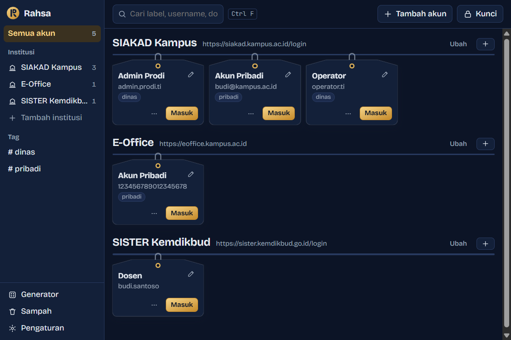
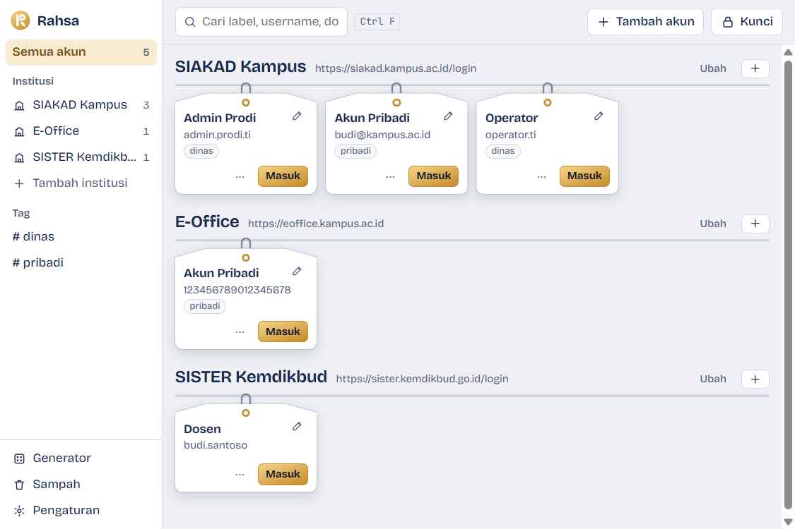
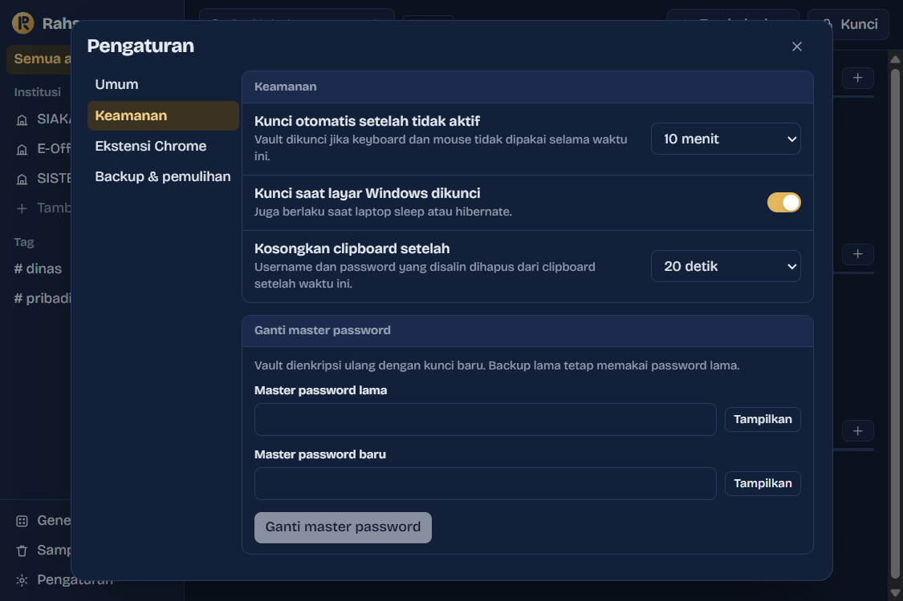

<p align="center">
  
</p>

<h1 align="center">Rahsa</h1>

<p align="center">
  Password manager lokal untuk Windows + Chrome.<br>
  Simpan banyak akun per situs, lalu login dengan satu klik. Tanpa server, tanpa cloud.
</p>

<p align="center">
  <a href="#instalasi">Instalasi</a> ·
  <a href="#cara-kerja">Cara kerja</a> ·
  <a href="#keamanan">Keamanan</a> ·
  <a href="#pengembangan">Pengembangan</a> ·
  <a href="#lisensi">Lisensi</a>
</p>

> **English summary:** Rahsa is a local-only password manager for Windows and Chrome. It keeps an encrypted vault on your own laptop (Argon2id + XChaCha20-Poly1305), lets you register several accounts per website, and signs you in with one click: the desktop app opens the login page and a Chrome extension fills and submits the form, only on the exact registered `https` origin. No server, no cloud sync, no telemetry, no network code. The UI is in Indonesian (default) and English.



## Kenapa Rahsa?

Banyak orang punya beberapa akun di web yang sama, misalnya akun pribadi, akun admin unit, dan akun operator di sistem kampus atau kantor. Mengetik ulang setiap kali melelahkan, menyimpannya di catatan atau Excel tidak aman, dan fitur simpan password bawaan browser sulit dipakai untuk memilih akun.

Rahsa dibuat untuk kebutuhan itu:

- **Login dalam hitungan detik.** Klik **Masuk** pada akun, lalu Chrome membuka halaman login, mengisi form, dan menekan tombol login.
- **Ganti akun otomatis.** Kalau Anda masih login sebagai akun lain, Rahsa mengeluarkannya dulu (menutup tab situs itu dan menghapus cookie-nya saja), baru masuk dengan akun yang dipilih.
- **Banyak akun per situs**, dikelompokkan per institusi, dengan label yang jelas.
- **Tahan phishing.** Password hanya diisi di alamat `https` yang terdaftar persis. `siakad.kampus.ac.id.evil.com` tidak akan pernah terisi.
- **Sepenuhnya lokal.** Vault terenkripsi tersimpan di laptop Anda. Aplikasi tidak punya kode jaringan sama sekali.

## Fitur

| | |
|---|---|
| **Vault terenkripsi** | Argon2id (256 MiB) + XChaCha20-Poly1305. Label, username, dan alamat situs ikut terenkripsi. |
| **Tombol Masuk** | Membuka halaman login di Chrome, mengisi, dan login otomatis (bisa dimatikan per akun). |
| **Ganti akun** | Logout akun lama otomatis sebelum login dengan akun lain (bisa dimatikan per institusi). |
| **Pengisian dari halaman** | Ikon Rahsa di field username, atau `Ctrl+Shift+L`, untuk memilih akun langsung dari web. |
| **Generator password** | 12–64 karakter, aturan simbol/angka khusus institusi, menghindari karakter mirip. |
| **Salin aman** | Clipboard dikosongkan otomatis dan tidak masuk riwayat clipboard Windows (`Win+V`). |
| **Kunci otomatis** | Saat tidak aktif, saat layar Windows dikunci, dan saat laptop sleep. |
| **Backup & pulihkan** | Ekspor file `.rahsa` terenkripsi, pulihkan di laptop baru dengan master password. |
| **Riwayat & sampah** | 5 password terakhir per akun tersimpan; akun yang dihapus bisa dipulihkan selama 30 hari. |
| **Tema** | Gelap/terang mengikuti Windows, Bahasa Indonesia dan English. |

<p>
  
  
</p>

## Instalasi

> Rahsa masih versi awal (0.1). Belum ada installer bertanda tangan dan ekstensinya belum ada di Chrome Web Store, jadi untuk sekarang dipasang dari source.

**Kebutuhan:** Windows 10 (22H2) atau 11 x64, Google Chrome 120+, [Rust](https://rustup.rs) (toolchain MSVC), Visual Studio Build Tools dengan workload C++, dan Node.js 20+.

```powershell
winget install Rustlang.Rustup
winget install Microsoft.VisualStudio.2022.BuildTools --override "--wait --passive --add Microsoft.VisualStudio.Workload.VCTools --includeRecommended"
```

**1. Build dan jalankan aplikasi**

```powershell
git clone <url-repo-ini> rahsa
cd rahsa
pwsh scripts/build.ps1 -Dev      # build native host + ekstensi
cd app
npm install
npm run tauri dev                # jalankan aplikasi desktop
```

Untuk membuat installer (`target/release/bundle/nsis/Rahsa_<versi>_x64-setup.exe`, dipasang per user tanpa hak admin):

```powershell
pwsh scripts/build.ps1
```

**2. Pasang ekstensi Chrome**

1. Buka `chrome://extensions` dan nyalakan **Developer mode**.
2. Klik **Load unpacked**, lalu pilih folder `extension/dist`.
3. ID ekstensi selalu `nahifcpmliobngflogfdhojbklmomgad` (dikunci oleh `key` di manifest). Hanya ID ini yang diizinkan berbicara dengan aplikasi.

Aplikasi otomatis mendaftarkan native messaging host di `HKCU` setiap kali dibuka.

## Pemakaian

1. **Buat vault.** Pilih master password minimal 12 karakter, lalu simpan Emergency Kit. Master password tidak bisa dipulihkan oleh siapa pun.
2. **Pasangkan ekstensi.** Klik ikon Rahsa di Chrome, pilih **Pasangkan**, cocokkan kode 6 digit dengan yang tampil di aplikasi, lalu setujui di aplikasi.
3. **Tambah institusi**: nama dan link halaman login (`https://…`). Lalu **tambah akun** di bawahnya.
4. **Izinkan situsnya.** Di popup ekstensi, klik **Izinkan**. Rahsa hanya membaca situs yang Anda setujui, bukan semua situs.
5. **Klik Masuk** pada kartu akun.

Alternatifnya, buka web institusi seperti biasa, klik ikon Rahsa di field username (atau tekan `Ctrl+Shift+L`), lalu pilih akun.

## Cara kerja

Rahsa terdiri dari tiga program lokal. Tidak ada yang membuka port jaringan atau menghubungi internet.

```
 Chrome                                    Windows (user yang sama)
┌──────────────────────────┐
│ content script           │  mendeteksi form login, mengisi setelah akun dipilih
│        │                 │
│ background (service      │
│ worker)                  │
└────────┼─────────────────┘
         │ native messaging (stdin/stdout)
         ▼
   rahsa-host.exe          hanya meneruskan pesan terenkripsi, tidak bisa membacanya
         │ named pipe \\.\pipe\rahsa-<SID>, hanya untuk user yang sedang login
         ▼
   Rahsa (Tauri)           memegang vault; dekripsi dan cek alamat situs terjadi di sini
         │
         ▼
   %APPDATA%\id.rahsa.desktop\vault.rahsa
```

- **Aplikasi desktop:** [Tauri 2](https://tauri.app). Backend Rust (kriptografi, vault, IPC), antarmuka React + TypeScript.
- **Ekstensi:** Chrome Manifest V3, TypeScript. Tidak pernah menyimpan password; ia meminta satu kredensial untuk satu akun, untuk tab yang meminta, setelah ada aksi pengguna.
- **Saluran ekstensi ⇄ aplikasi** dienkripsi end-to-end setelah pairing (X25519 + HKDF-SHA256 + XChaCha20-Poly1305), jadi native host hanya melihat ciphertext.

Struktur repository:

```
crates/rahsa-core   format vault, kriptografi, pencocokan alamat, generator, kripto sesi, helper Win32
crates/rahsa-host   native messaging host (rahsa-host.exe)
app/                aplikasi desktop Tauri (src-tauri = Rust, src = React)
extension/          ekstensi Chrome
docs/               format vault, checklist keamanan, screenshot
assets/rahsa-logo/  logo dan ikon
scripts/            skrip build
```

## Keamanan

Rahsa melindungi password dari **pencurian file vault**, **phishing**, dan **program lain di laptop yang berjalan tanpa hak admin**.

- Vault dienkripsi dengan kunci acak 32 byte; master password (lewat Argon2id) hanya membungkus kunci itu. Seluruh header file ikut diautentikasi, jadi perubahan satu byte saja membuat vault ditolak.
- Kunci vault hanya ada di memori proses Rust dan dihapus (`zeroize`) saat vault dikunci. Antarmuka hanya menerima data yang sedang ditampilkan.
- Pengisian hanya terjadi di `https` dengan alamat yang persis terdaftar, setelah ada aksi pengguna, dan tidak pernah ke field tersembunyi atau iframe dari domain lain.
- Named pipe hanya bisa dibuka oleh user Windows yang sama, dan aplikasi memeriksa bahwa yang terhubung adalah `rahsa-host.exe` dari folder aplikasinya sendiri.
- Permintaan kredensial dibatasi 10 per menit dan memakai nonce anti-replay.

**Yang tidak bisa dilindungi:** malware yang sudah berjalan dengan hak admin saat vault terbuka. Batas ini berlaku untuk semua password manager.

Detailnya ada di [docs/security-checklist.md](docs/security-checklist.md) (threat model dan bukti uji) dan [docs/vault-format.md](docs/vault-format.md). Format vault sengaja didokumentasikan terbuka supaya data Anda tetap bisa dibaca walaupun proyek ini berhenti dikembangkan.

> ⚠️ Kode ini belum diaudit oleh pihak independen. Pertimbangkan itu sebelum menyimpan akun penting, dan selalu simpan backup.

### Melaporkan celah keamanan

Jangan laporkan celah keamanan lewat issue publik. Gunakan fitur **Report a vulnerability** (Security → Advisories) di repository ini, supaya laporannya bisa ditangani secara privat dulu.

## Pengembangan

```powershell
cargo test --workspace           # vektor uji RFC, deteksi perubahan file, tabel phishing, generator, penyimpanan atomik
cd extension; npm test           # kripto Rust ⇄ TypeScript identik + halaman jebakan di Chrome headless
cd app; npx tsc --noEmit         # cek tipe antarmuka
```

Saat aplikasi debug berjalan, variabel `RAHSA_DATA_DIR` bisa diarahkan ke folder lain supaya pengujian tidak menyentuh vault asli Anda. Variabel ini diabaikan di build release.

### Keputusan desain yang perlu diketahui

- **Data pairing ekstensi** disimpan di `pairing.dat` (dilindungi DPAPI), terpisah dari vault, karena aplikasi harus bisa mengenali ekstensi saat vault terkunci. File ini tidak berisi data akun.
- **Izin ekstensi**: `nativeMessaging`, `activeTab`, `storage`, `scripting` (untuk mendaftarkan content script hanya di situs yang diizinkan), dan `browsingData` (untuk fitur ganti akun). Akses ke situs diminta satu per satu, tidak pernah `<all_urls>`.
- **Verifikasi `rahsa-host.exe`** saat ini berdasarkan lokasi file. Verifikasi tanda tangan digital (Authenticode) menyusul setelah ada sertifikat code signing.

### Rencana

- Unlock dengan Windows Hello
- Tawaran "Simpan akun ini?" setelah login manual
- Impor dari CSV Chrome / KeePass
- Audit kesehatan password (lemah, dipakai ulang, terlalu lama)
- Login bertahap (SSO) dan dukungan Microsoft Edge
- Installer bertanda tangan dan publikasi ekstensi di Chrome Web Store

Kontribusi dipersilakan. Untuk perubahan besar, buka issue dulu untuk mendiskusikan arahnya. Perubahan pada `crates/rahsa-core` atau protokol ekstensi harus disertai test.

## Lisensi

[MIT](LICENSE)
